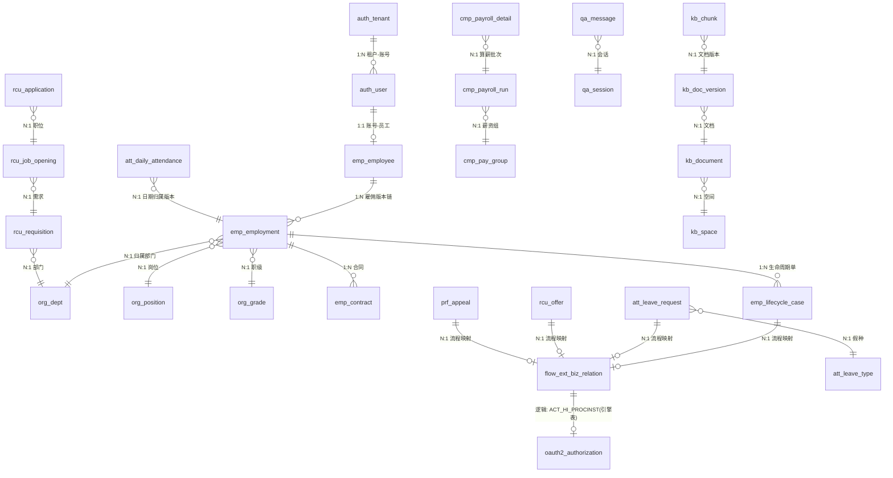

# 12 数据库详细设计（双库支持：MySQL 8.0 / PostgreSQL 15+）

> 项目代号：hris-pro　版本：v1.0　日期：2026-10-15
> 上游基线：《02 系统架构设计》《06 数据模型设计》《08 安全与多租户设计》《04 工作流引擎详细设计》《05 知识库与 RAG 详细设计》
> 本文为字段级 DDL 的权威设计文档，配套两份可执行 DDL：
> - `docs/db/schema-mysql.sql`
> - `docs/db/schema-postgresql.sql`
> 决策记录：`docs/decisions/ADR-006.md`（双库支持）

---

## 1. 双库支持决策总述

数据层原锁定 MySQL，现扩展为**一套业务逻辑、双份方言 DDL** 同时支持 MySQL 8.0 与 PostgreSQL 15+。核心策略：

1. **应用层方言中立**：MyBatis-Plus Mapper 与 Service 不写裸方言 SQL；主键、时间戳、布尔、updated_at、掩码列均在应用层或公共列约定层收敛，消灭两库行为差异。
2. **DDL 双份维护**：字段/索引变更同步改两份 DDL，由 Liquibase 基线 + CodeReview 双文件对照清单防漂移。
3. **方言差异收口到 repository 层**：仅 upsert、JSON 特殊查询、全文检索等无法中立的 SQL 在 repository 层提供方言实现，其余全走 MyBatis-Plus 通用方法。

ShardingSphere-JDBC 5.4.x+ 继续作为唯一分片/加密层，同一版本同时适配两种方言（验证结论见 ADR-006）。

---

## 2. 方言兼容策略表（MySQL 8.0 vs PostgreSQL 15+）

| # | 项 | MySQL 8.0 | PostgreSQL 15+ | 本项目统一约定 |
|---|---|---|---|---|
| 1 | 主键 | BIGINT | BIGINT | 雪花 ID（含租户位段）应用层生成，禁 AUTO_INCREMENT / IDENTITY / SERIAL |
| 2 | 时间戳 | DATETIME(3) | TIMESTAMP(3) | 统一「存 UTC、无时区」；created_at 用 DEFAULT CURRENT_TIMESTAMP(3)，updated_at 由 MP MetaObjectHandler 应用层填充，MySQL 不用 ON UPDATE、PG 不用触发器 |
| 3 | 日期 | DATE | DATE | 业务日期（生日、生效日、考勤日） |
| 4 | 布尔/开关 | TINYINT | SMALLINT | 统一整数 0/1，禁 MySQL BOOLEAN/TINYINT(1) 与 PG boolean 混用 |
| 5 | 逻辑删除 | TINYINT | SMALLINT | deleted 0=未删 1=已删，MP @TableLogic |
| 6 | 金额 | DECIMAL(18,4) | NUMERIC(18,4) | 薪酬内部计算位，展示层 2 位 |
| 7 | 短文本 | VARCHAR(n) | VARCHAR(n) | 明确上限，不滥用 TEXT |
| 8 | 长文本/大字段 | TEXT / MEDIUMTEXT | TEXT | 仅占位；>64KB 一律走 MinIO 引用（`file_id`/`object_key`），不落库 |
| 9 | JSON | JSON | JSONB | 仅 payload/snapshot/config；不做过滤/唯一/排序；需检索字段提升为标量影子列 |
| 10 | 二进制 | VARBINARY(n)/BLOB | BYTEA | 附件内容不落库；token/密文如落库用此类型 |
| 11 | 字符集/排序 | utf8mb4_0900_ai_ci | UTF-8（默认） | PG 无 ai_ci 等价物：标识符类字段（code/username/emp_no 等）应用层写路径统一 trim+lower 规范化；MySQL ai_ci 兜底；PG 对关键登录字段 auth_user.username 建 `lower()` 函数唯一索引双保险；中文姓名排序用应用生成 `pinyin_sort_key` 影子列 + 普通索引 |
| 12 | 唯一约束 | UNIQUE(tenant_id, xxx) | UNIQUE(tenant_id, xxx) | 一律 `(tenant_id, xxx)` 复合前缀 |
| 13 | upsert | INSERT..ON DUPLICATE KEY UPDATE | INSERT..ON CONFLICT (uk) DO UPDATE | repository 层方言实现收口 |
| 14 | 分页 | LIMIT n OFFSET m | LIMIT n OFFSET m | 一致，MP Page 通用 |
| 15 | 自增/序列 | 禁 | 禁 | 由雪花 ID 承担 |
| 16 | 分区 | RANGE(punch_time) | RANGE(punch_time) | 分区键须进主键/唯一键（两库同要求）；分区由调度任务按月自动建/删 |
| 17 | 外键 | 不建物理外键 | 不建物理外键 | SaaS 惯例 + 分片 + 软删 + 跨库一致性；引用完整性由应用 + 对账保证，DDL 仅注释标注逻辑外键 |

### 2.1 加密列落地约定（双库一致）

每敏感字段在表上建**两列**（应用逻辑列不建实体列，由 ShardingSphere 加密规则映射）：

| 层 | 列名 | 说明 |
|---|---|---|
| 应用逻辑列 | `{col}`（如 `cert_no`） | 仅存在于 Mapper/实体，读写明文；ShardingSphere 配置 logicColumn |
| 密文列 | `{col}_cipher`（如 `cert_no_cipher`） | 物理列，存 AES-256-GCM 密文（Base64，VARCHAR，含 IV/Tag 长度余量） |
| 掩码影子列 | `{col}_mask`（如 `cert_no_mask`） | 物理列，存脱敏值（保留首尾），用于列表展示、脱敏检索、审计 |

- 加密列通用限制：**不可范围比较 / ORDER BY / LIKE / 聚合计算**，检索一律走掩码列（前缀/等值由应用按场景裁剪）。
- 密钥：KMS 信封加密，年度轮换。

---

## 3. 分库分片策略

- **物理分库**：11 服务逻辑分库（一服务一域一库）；flow_db 独立实例（Flowable 引擎表 ACT_* 由引擎自动建）。
- **分片（ShardingSphere-JDBC 5.4.x+）**：
  - 分片算法：`tenant_id MOD 16` 起步（16 物理片），扩容走一致性哈希 + 数据迁移任务；同一租户数据恒落同一片。
  - **分片表（16 片）**：emp 域全部租户业务表（emp_employee / emp_employment / emp_profile_* / emp_contract / emp_lifecycle_case / emp_pending_transaction / emp_status_log / emp_change_audit，绑定表组保证同租户可 JOIN）；att_punch_record（分片 + 按月分区）。
  - **广播表（global broadcast，全片复制）**：sys_dict_type、sys_dict_item、sys_tenant_config、org_grade_band。
  - **单表（默认数据源，不拆分）**：其余表。
- **大表二级策略**：att_punch_record 按 tenant_id 分片 + `punch_time` RANGE 月分区（保 13 个月热数据，超期归档对象存储 Parquet 后删分区）。
- **头部租户**：auth_tenant.storage_mode = SHARED | DEDICATED；DEDICATED 路由到专属数据源（ShardingSphere 混合分片规则），DDL 与共享模式完全一致（专属 DS 复用同一 schema 基线）。

> 说明：DDL 中不体现「分片/广播/单表」的物理区别——这些是 ShardingSphere 路由规则在运行时决定的逻辑视图，物理表命名由配置的 actual-data-nodes 决定。DDL 负责定义「逻辑表」字段结构，分片规则在 ShardingSphere 配置（DistSQL/YAML）中维护。

---

## 4. 全局建模规范

| 项 | 规范 |
|---|---|
| 主键 | `id BIGINT` 雪花 ID（含租户位段），应用层生成，禁自增 |
| 公共列 | `tenant_id BIGINT NOT NULL`、`created_by / updated_by BIGINT NOT NULL DEFAULT 0`、`created_at / updated_at`（毫秒精度，存 UTC）、`deleted`（0/1 逻辑删）、`version`（乐观锁） |
| 唯一约束 | 一律 `(tenant_id, xxx)` 复合前缀 |
| 金额 | DECIMAL(18,4) / NUMERIC(18,4) |
| 时间 | 存 UTC；业务日期用 DATE |
| 枚举 | 字典表（sys_dict_type/item）+ 代码常量，禁魔法数字入注释 |
| 大字段 | >64KB 走 MinIO 引用；字段级可先用 TEXT/JSONB 占位并注释说明 |
| 敏感字段 | 列级加密（密文列 + 掩码影子列），见 §2.1 |
| 外键 | 不建物理外键，逻辑外键在注释与 ER 图中标注 |
| 命名 | 表名蛇形 + 域前缀（auth_/org_/emp_/att_/rcu_/cmp_/prf_/flow_ext_/kb_/qa_/sys_）；列名蛇形 |

---

## 5. 11 域表清单总览

> 完整字段级 DDL 见两份 SQL。此处列每域表名、用途、关键索引/约束。

### 5.1 auth_db（认证授权，9 表）
| 表 | 用途 | 关键约束/索引 |
|---|---|---|
| auth_tenant | 租户主档（code/storage_mode/plan/status/timezone/domain） | uk(tenant_id=自反不可用, 实为 uk(code) 平台级)、uk(domain) |
| auth_user | 一人一账号，离职禁用 | uk(tenant_id, username)、uk(tenant_id, employee_id)、idx(tenant_id, status) |
| auth_role | 租户角色 | uk(tenant_id, code) |
| auth_role_perm | 角色-权限点（`模块:资源:动作`） | uk(role_id, perm_code) |
| auth_user_role | 用户-角色 | uk(user_id, role_id) |
| auth_data_scope | 数据权限规则（SELF/DEPT/DEPT_SUB/CUSTOM/ALL） | idx(role_id) |
| oauth2_registered_client | OAuth2 客户端注册（Spring Authorization Server 官方表） | pk(client_id 相关，官方 schema) |
| oauth2_authorization | OAuth2 授权/token 存储（官方表） | idx(registered_client_id, principal_name) |
| oauth2_authorization_consent | OAuth2 授权同意（官方表） | pk(registered_client_id, principal_name) |

> 说明：oauth2_* 三表为 Spring Authorization Server 官方 schema 的双方言适配版，通常由框架 JDBC 初始化自动建；此处给出基线以便统一维护与审计。三表为平台级基础设施，不带 tenant_id（租户在 JWT claims/principal 中承载）。

### 5.2 org_db（组织岗位，9 表）
| 表 | 用途 | 关键约束/索引 |
|---|---|---|
| org_legal_entity | 法人主体 | uk(tenant_id, uscc) |
| org_dept | 部门树 + 版本化生效 | uk(tenant_id, code)、idx(tenant_id, parent_id)、idx(tenant_id, path) |
| org_position | 岗位 | uk(tenant_id, code) |
| org_job | 职务/职级序列 | uk(tenant_id, code) |
| org_grade | 职级 | uk(tenant_id, code) |
| org_grade_band | 职级带（广播表） | uk(tenant_id, code) |
| org_headcount | 编制 | uk(tenant_id, dept_id, position_id, period) |
| org_hc_occupancy | 编制占用流水 | idx(tenant_id, emp_id) |
| org_dept_history | 部门每日/变更快照 | idx(tenant_id, dept_id, snapshot_date) |

### 5.3 emp_db（员工，11 表，全部按 tenant_id 分片）
| 表 | 用途 | 关键约束/索引 |
|---|---|---|
| emp_employee | 员工主档（emp_no/姓名/证件/手机，加密列） | uk(tenant_id, emp_no)、idx(tenant_id, status) |
| emp_employment | 雇佣关系版本链（核心） | uk(tenant_id, emp_id, effective_from)、idx(tenant_id, dept_id)、idx(tenant_id, position_id) |
| emp_profile_education | 教育经历 | idx(tenant_id, employee_id) |
| emp_profile_work | 工作经历 | idx(tenant_id, employee_id) |
| emp_profile_family | 家庭成员 | idx(tenant_id, employee_id) |
| emp_profile_emergency | 紧急联系人 | idx(tenant_id, employee_id) |
| emp_contract | 合同台账 | uk(tenant_id, contract_no)、idx(tenant_id, emp_id) |
| emp_lifecycle_case | 生命周期单（入转调离） | uk(tenant_id, biz_key)、idx(tenant_id, emp_id, type) |
| emp_pending_transaction | 待生效事务队列（幂等落账） | uk(tenant_id, trans_no)、idx(tenant_id, effect_date) |
| emp_status_log | 员工状态流水 | idx(tenant_id, emp_id, created_at) |
| emp_change_audit | 字段变更审计（old/new diff） | idx(tenant_id, emp_id, field_name) |

### 5.4 att_db（假勤，16 表）
| 表 | 用途 | 关键约束/索引 |
|---|---|---|
| att_punch_record | 打卡记录（分片 + 月分区） | pk(id, punch_time)、uk(tenant_id, emp_id, punch_time) |
| att_group | 班组 | uk(tenant_id, code) |
| att_shift | 班次 | uk(tenant_id, code) |
| att_shift_assignment | 排班 | uk(tenant_id, emp_id, work_date)、idx(tenant_id, shift_id, work_date) |
| att_daily_attendance | 日考勤结果 | uk(tenant_id, emp_id, work_date) |
| att_exception | 考勤异常 | idx(tenant_id, emp_id, work_date, status) |
| att_leave_type | 假种（规则 json） | uk(tenant_id, code) |
| att_leave_quota | 假期额度 | uk(tenant_id, emp_id, leave_type_id, period) |
| att_leave_ledger | 额度流水 | idx(tenant_id, emp_id, leave_type_id) |
| att_leave_request | 请假单（关联 flow） | uk(tenant_id, biz_key)、idx(tenant_id, emp_id, status) |
| att_overtime_request | 加班单 | uk(tenant_id, biz_key) |
| att_trip_request | 出差单 | uk(tenant_id, biz_key) |
| att_fix_request | 补卡单 | uk(tenant_id, biz_key) |
| att_payroll_cycle | 薪酬取数周期 | uk(tenant_id, period_code) |
| att_monthly_closing | 月结批次 | uk(tenant_id, period_code)、idx(tenant_id, status) |
| att_closing_adjustment | 月结调整 | idx(tenant_id, emp_id, closing_id) |

### 5.5 rcu_db（招聘，11 表）
| 表 | 用途 | 关键约束/索引 |
|---|---|---|
| rcu_requisition | 招聘需求 | uk(tenant_id, req_no)、idx(tenant_id, dept_id) |
| rcu_job_opening | 职位 | uk(tenant_id, code)、idx(tenant_id, status) |
| rcu_channel | 招聘渠道 | uk(tenant_id, code) |
| rcu_candidate | 候选人（mobile 加密） | uk(tenant_id, mobile_mask, name)、idx(tenant_id, status) |
| rcu_resume | 简历（file_id + parse_result json） | idx(tenant_id, candidate_id) |
| rcu_application | 投递（uk candidate+opening） | uk(tenant_id, candidate_id, opening_id) |
| rcu_stage_log | 阶段流转日志 | idx(tenant_id, application_id, created_at) |
| rcu_interview | 面试安排 | idx(tenant_id, application_id, planned_at) |
| rcu_interview_eval | 面试评价 | idx(tenant_id, interview_id, evaluator_id) |
| rcu_offer | Offer（流程关联 + 薪资带校验） | uk(tenant_id, offer_no)、idx(tenant_id, application_id) |
| rcu_talent_pool_tag | 人才库标签 | uk(tenant_id, candidate_id, tag) |

### 5.6 cmp_db（薪酬，12 表）
| 表 | 用途 | 关键约束/索引 |
|---|---|---|
| cmp_pay_item | 薪酬项（公式 json 版本化） | uk(tenant_id, code, version) |
| cmp_pay_group | 薪资组 | uk(tenant_id, code) |
| cmp_pay_grade | 薪级 | uk(tenant_id, code) |
| cmp_employee_pay | 员工定薪（生效区间版本，金额加密） | uk(tenant_id, emp_id, effective_from) |
| cmp_social_fund_profile | 社保公积金档案 | uk(tenant_id, emp_id, effective_from) |
| cmp_tax_deduction | 专项附加扣除（加密） | uk(tenant_id, emp_id, effective_from) |
| cmp_payroll_run | 算薪批次（状态机） | uk(tenant_id, period_code, pay_group_id) |
| cmp_payroll_detail | 算薪明细（run+emp，输入快照 json） | uk(tenant_id, run_id, emp_id)、idx(tenant_id, run_id) |
| cmp_payroll_adjustment | 算薪调整 | idx(tenant_id, run_id, emp_id) |
| cmp_payment_instruction | 发放指令 | uk(tenant_id, run_id, emp_id) |
| cmp_payslip | 工资条（密文 + 发放状态） | uk(tenant_id, run_id, emp_id) |
| cmp_import_batch | 导入批次 | uk(tenant_id, batch_no) |

### 5.7 prf_db（绩效与培训，16 表）
| 表 | 用途 | 关键约束/索引 |
|---|---|---|
| prf_plan | 考核方案 | uk(tenant_id, code) |
| prf_cycle | 考核周期 | uk(tenant_id, plan_id, period_code) |
| prf_goal | 目标（KPI 权重） | idx(tenant_id, cycle_id, emp_id) |
| prf_okr_objective | OKR 目标 | idx(tenant_id, cycle_id, emp_id) |
| prf_eval_task | 评估任务 | uk(tenant_id, cycle_id, emp_id, evaluator_role) |
| prf_evaluation | 评价（评价人环 json） | uk(tenant_id, task_id, evaluator_id) |
| prf_forced_rule | 强制分布规则 | uk(tenant_id, plan_id) |
| prf_calibration_session | 校准会议 | uk(tenant_id, cycle_id, dept_id) |
| prf_calibration_snapshot | 校准快照 | idx(tenant_id, session_id) |
| prf_appeal | 申诉（关联 flow） | uk(tenant_id, biz_key) |
| prf_train_plan | 培训计划 | uk(tenant_id, code) |
| prf_course | 课程 | uk(tenant_id, code) |
| prf_instructor | 讲师 | uk(tenant_id, emp_id) |
| prf_class_session | 开班场次 | idx(tenant_id, course_id, start_at) |
| prf_enrollment | 报名/参训 | uk(tenant_id, session_id, emp_id) |
| prf_credit_ledger | 学时台账 | idx(tenant_id, emp_id, created_at) |

### 5.8 flow_db（流程中台，仅 6 张扩展表）
| 表 | 用途 | 关键约束/索引 |
|---|---|---|
| flow_ext_biz_relation | 业务单据↔流程实例映射（发起幂等锁） | uk(tenant_id, biz_type, biz_key)、idx(tenant_id, proc_inst_id) |
| flow_ext_model | 模型草稿/部署记录 | uk(tenant_id, proc_def_key, version) |
| flow_ext_node_form | 节点级表单绑定 | uk(tenant_id, proc_def_id, node_id) |
| flow_ext_task_action | 审批动作明细（意见/附件/委托链） | idx(tenant_id, task_id, created_at) |
| flow_ext_event_outbox | 事件出站表（事务消息兜底） | uk(event_id)、idx(state, next_retry_at) |
| flow_ext_timeout_cfg | 节点超时催办/升级配置 | uk(tenant_id, proc_def_id, node_id) |

> Flowable 原生 ACT_RE_* / ACT_RU_* / ACT_HI_* 表由引擎按官方 schema 自动建，本文不展开。

### 5.9 rag_db（知识库与问答，13 表）
| 表 | 用途 | 关键约束/索引 |
|---|---|---|
| kb_space | 知识空间 | uk(tenant_id, code) |
| kb_space_member | 空间成员 | uk(tenant_id, space_id, user_id) |
| kb_acl_tag | 权限标签字典 | uk(tenant_id, code) |
| kb_document | 文档主档 | uk(tenant_id, space_id, title_hash) |
| kb_doc_version | 文档版本（状态机） | uk(tenant_id, document_id, version) |
| kb_chunk | 切片（doc_version_id/embedding 引用） | idx(tenant_id, doc_version_id, seq)、idx(tenant_id, space_id) |
| qa_session | 问答会话 | idx(tenant_id, user_id, created_at) |
| qa_message | 问答消息（refs/tool_calls json） | idx(tenant_id, session_id, created_at) |
| qa_feedback | 问答反馈 | idx(tenant_id, message_id) |
| kb_govern_ticket | 知识治理工单 | idx(tenant_id, doc_version_id, status) |
| kb_eval_set | 评测集 | uk(tenant_id, code) |
| kb_eval_case | 评测用例 | idx(tenant_id, eval_set_id) |
| kb_eval_run | 评测运行（指标快照） | idx(tenant_id, eval_set_id, created_at) |

### 5.10 plt_db（平台支撑，11 表）
| 表 | 用途 | 关键约束/索引 |
|---|---|---|
| sys_dict_type | 字典类型（广播表） | uk(tenant_id, code) |
| sys_dict_item | 字典项（广播表） | uk(tenant_id, type_code, value) |
| sys_tenant_config | 租户参数（广播表） | uk(tenant_id, config_key) |
| sys_file_meta | 文件元数据（bucket/key/水印策略） | uk(tenant_id, bucket, object_key) |
| sys_notify_template | 通知模板 | uk(tenant_id, code, channel) |
| sys_notify_record | 通知记录 | idx(tenant_id, user_id, created_at) |
| sys_report_def | 报表定义 | uk(tenant_id, code) |
| sys_export_task | 异步导出任务 | idx(tenant_id, status, created_at) |
| sys_audit_log | 审计日志（月分区，只追加） | idx(tenant_id, created_at)、idx(tenant_id, actor_id) |
| sys_scheduler_task_registry | 调度任务注册 | uk(tenant_id, task_key) |
| sys_outbox_message | 全局事件表（事务消息模板） | uk(event_id)、idx(state, next_retry_at) |

**统计**：auth 9 + org 9 + emp 11 + att 16 + rcu 11 + cmp 12 + prf 16 + flow 6 + rag 13 + plt 11 = **114 张逻辑表**（不含 Flowable ACT_* 引擎表）。

---

## 6. ER 主干（Mermaid）

约定：跨库一律不设物理外键，一致性经事件 + 对账（04 §7、02 §3）；员工归属一律经 `emp_employment` 生效区间查询，禁止各域冗余 dept_id 长挂。

---

## 7. 索引策略

1. **主键**：id（雪花）聚簇（MySQL InnoDB）/ PG 主键索引。
2. **唯一约束**：一律 `(tenant_id, 业务键)` 复合前缀；纯业务键全局唯一用平台级唯一索引（如 auth_tenant.code、sys_* 的 event_id）。
3. **二级索引**：`tenant_id` 前缀 + 高频过滤列；逻辑外键列（dept_id/emp_id/employee_id/run_id 等）+ tenant_id 前缀；排序列（created_at/work_date）。
4. **分页/排序**：花名册、待办列表等列表查询建 `(tenant_id, status, created_at)` 或等价组合，避免 filesort/全表扫。
5. **加密列不建索引**（密文不可比较）；检索走掩码列，掩码列按需建前缀索引。
6. **MVP 不建复合索引**（除非查询模式已明确）；索引随慢查询按需加，避免过早优化。
7. **大表**：att_punch_record / sys_audit_log 按月分区，热数据 13 个月。

---

## 8. 迁移方案（Flyway / Liquibase 选型）

**推荐 Liquibase**，理由：

| 维度 | Liquibase | Flyway |
|---|---|---|
| 双方言一套定义 | changelog 用 `<dbms>` 条件片段区分，一套维护两库 | 原生一套 migration 不能跑两库，需按目录 `db/migration/{mysql,postgresql}` 分两份 |
| diff/回滚 | 内置 diff、rollback 支持好 | rollback 需手写 undo |
| Java 栈集成 | Spring Boot 官方支持 | Spring Boot 官方支持 |
| 团队熟悉度 | 中等 | 高（Java 团队更熟 Flyway） |

策略：
- 以本文两份 DDL 为 **v1 基线**，Liquibase 用 `<changeSet>` 加载对应方言的基线脚本（`<dbms type="mysql">` / `<dbms type="postgresql">`）。
- 增量变更一律走 Liquibase changeSet（不手改基线），字段/索引变更双文件对照 CodeReview 清单。
- 若团队坚持 Flyway：按 `locations=classpath:db/migration/{mysql,postgresql}` 分目录，`V{n}__*.sql` 双份维护，成本略高但可接受。

---

## 9. 加密与敏感字段清单

| 域 | 字段 | 密文列 | 掩码列 | 策略 |
|---|---|---|---|---|
| emp | 身份证号 | cert_no_cipher | cert_no_mask | AES-256-GCM |
| emp | 手机号 | mobile_cipher | mobile_mask | AES-256-GCM |
| rcu | 候选人手机号 | mobile_cipher | mobile_mask | AES-256-GCM |
| cmp | 银行账号 | bank_account_cipher | bank_account_mask | AES-256-GCM |
| cmp | 定薪金额 | salary_amount_cipher | salary_amount_mask | AES-256-GCM |
| cmp | 算薪明细金额（应发/实发） | amount_cipher / net_amount_cipher | amount_mask / net_amount_mask | AES-256-GCM |
| cmp | 专项附加扣除 | deduction_amount_cipher | deduction_amount_mask | AES-256-GCM |
| cmp | 工资条净额 | net_pay_cipher | net_pay_mask | AES-256-GCM |

其余：简历全文/合同附件走 MinIO SSE-KMS；检索内容（chunk）入 ES/Milvus 前 PII 占位符化（05）。

---

## 10. 容量与归档

- emp_employment 版本链 ~5 万行/年；att_punch_record 300 万行/年（分区）；att_daily_attendance 250 万/年；cmp_payroll_detail 12 万/年；flow 任务 50 万/年；qa_message 100 万/年。
- 热数据 13 个月；其余归档对象存储 Parquet + 查询联邦预留。
- 分区由 platform 调度任务（sys_scheduler_task_registry）每月自动建下月分区、删超期分区（归档后 drop）。
